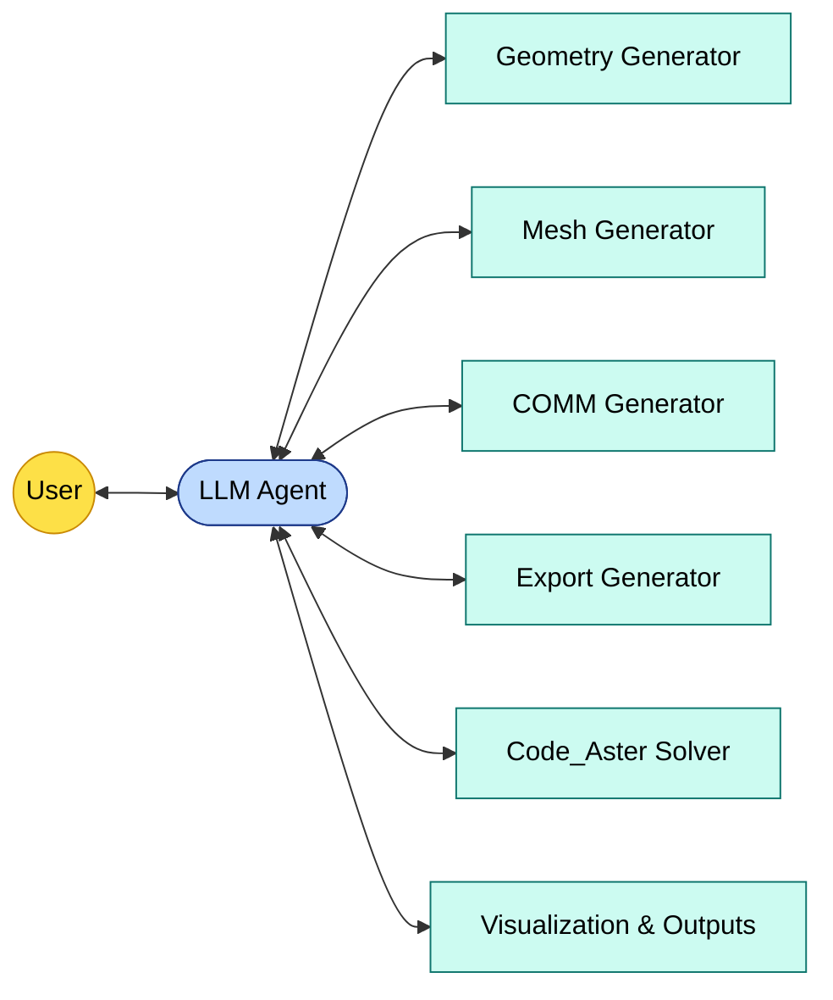

# 🤖 LLM-Driven Code_Aster Automation
### A Showcase of My Work on AI-Assisted Structural Analysis

**Amir Yarmohamadi — 2025**

---

## 🚀 Overview

This repository showcases **my technical contributions** to a collaborative project with **Saeideh Mohammadikish**, where we developed an **LLM-based automation pipeline for the Code_Aster FEM solver** using Python, LangChain, OpenAI, Code_Aster, and Gmsh.

The system enables users to describe structural engineering problems in natural language, automatically transforming their requests into complete finite element analysis workflows.

The pipeline automates the following stages:

- Natural language input and parameter extraction
- Geometry generation (`.geo`)
- Mesh generation (`.med`)
- Code_Aster command file generation (`.comm`)
- Solver configuration (`.export`)
- Numerical analysis execution
- Result extraction and visualization

All stages are coordinated through an LLM-based agent capable of interpreting user requests and orchestrating the appropriate engineering tools.

The main objective is to combine the flexibility of LLMs with deterministic engineering operations, reducing repetitive manual tasks while maintaining a structured and reproducible analysis workflow.

**Original Full Project Repository:**  
👉 [Main Repository](https://github.com/smohammadikish/training)

---


## 🎬 Demo

Watch the system transform a natural-language structural engineering request into an automated finite element analysis workflow.

[▶️ **Watch the Demo Video (MP4)**](https://github.com/AmirYarmhmdi/codeaster-llm-agent-showcase/blob/main/Demo.mp4)

The demonstration highlights the main stages of the automation pipeline:

1. User describes a structural problem in natural language.
2. The LLM agent extracts the required engineering parameters.
3. Geometry and mesh are generated automatically.
4. Code_Aster command and export files are created.
5. The FEM solver executes the analysis.
6. Results are extracted and visualized.

### Example User Input

```text
Simulate a 5m concrete beam, rectangular section 0.35m x 0.25m,
load 1300 N at the free end.
```


---

## 🧩 My Main Contributions

Below is a concise and accurate summary of the components I designed and implemented.

---

### 🔹 1. Multi-Stage Architecture Design

Designed the high-level pipeline that transforms a user's natural-language request into a complete Code_Aster analysis workflow.

The pipeline consists of:

1. Parameter extraction
2. Geometry generation (Gmsh)
3. Mesh generation
4. `.comm` file generation
5. `.export` file creation
6. Solver execution
7. Result extraction and visualization

This architecture provides the foundation for coordinating individual engineering modules through an LLM-based agent.

---

### 🔹 2. Geometry Generator (Gmsh)

Implemented the complete geometry generation module (`geo_generator.py`).

Key functionalities:

- Automatic beam geometry generation
- Transfinite partitioning
- Structured node generation
- mm ↔ m conversion logic
- Parameter validation
- Workspace synchronization

---

### 🔹 3. Mesh Generator

Developed a consistent and error-resistant meshing process.

Key functionalities:

- Structured 1D/2D mesh generation
- Element sizing rules
- Integration with the workspace pipeline
- Consistent mesh generation
- Error handling and reporting

---

### 🔹 4. Code_Aster `.comm` File Generator

Implemented the automated generation of Code_Aster command files, translating structural model parameters into solver-ready FEM definitions.

Key functionalities:

- Finite element model definition
- Material property assignment
- Rectangular section definition
- Load and boundary condition configuration
- Extraction of reactions, stresses, and displacements
- Structured and readable command generation

---

### 🔹 5. Export File Generator

Automated the creation of Code_Aster `.export` files to configure and manage solver execution.

Key functionalities:

- Automatic path configuration
- Standardized filenames
- Support for multiple analysis runs
- Workspace initialization and cleanup
- Integration with the solver execution workflow

---

### 🔹 6. AI Integration (LangChain + OpenAI)

Implemented the AI layer responsible for interpreting user requests and orchestrating the engineering workflow.

Key functionalities:

- Natural-language engineering parameter extraction
- Structured JSON generation
- Tool selection and execution orchestration
- Sequential routing between geometry, mesh, command generation, export, and solver execution
- Defensive parsing and validation
- Hybrid agent execution mode
- Interactive and scripted execution

The LLM acts as the orchestration layer, while the underlying engineering operations are performed by dedicated Python modules and established FEM tools.

---

### 🔹 7. Workspace Manager

Designed a reproducible workspace structure to organize generated files and maintain consistency across analysis stages.

Example workspace structure:

```text
workspace/
├── model.geo
├── model.med
├── model.comm
├── model.export
└── results/
```

This structure supports organized file management and multiple analysis runs.

---

## 🧪 Example Workflow

### User Input

```text
Simulate a 5m concrete beam, rectangular section 0.35m x 0.25m,
load 1300 N at the free end.
```

### Automated by the LLM Agent

1. Parameter extraction
2. Geometry generation
3. Mesh creation
4. Code_Aster `.comm` file generation
5. `.export` file creation
6. Code_Aster solver execution
7. Result extraction and visualization

---

## 🧱 System Architecture (High-Level)



---

## 📌 Features

- Natural-language-driven structural analysis
- Automated FEM workflow
- Modular and extensible Python architecture
- Integration with OpenAI and LangChain
- LLM-based tool orchestration
- Automated geometry and mesh generation
- Automatic Code_Aster input file generation
- Error-aware execution
- Automatic result extraction and plotting

---

## 🛠️ Technology Stack

| Category | Technologies |
|---|---|
| Programming Language | Python |
| LLM Integration | OpenAI API, LangChain |
| AI Orchestration | LLM Agent, Tool Calling |
| Geometry Generation | Gmsh |
| FEM Solver | Code_Aster |
| Mesh Format | MED |
| Input / Configuration | COMM, EXPORT |
| Data Exchange | JSON |
| Visualization | Python Plotting Tools |

---

## 🤝 Collaboration

Developed collaboratively with:

**Saeideh Mohammadikish**

The project combines structural engineering knowledge, Python development, and LLM-based automation to explore practical applications of artificial intelligence in computational structural analysis.

**Original Full Project Repository:**  
👉 [github.com/smohammadikish/training](https://github.com/smohammadikish/training)

---

## ⭐ Support

If you find this repository useful or inspiring, please consider giving it a ⭐.
